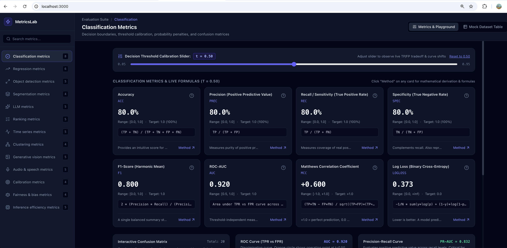

# MetricsLab AI Evaluation

## How to Run

1. Type `npm install`
2. Type `npm run dev`
3. Open `http://localhost:3000`

The left pane shows the different categories of questions, and the right pane shows the metrics dashboard and interactive effect.

